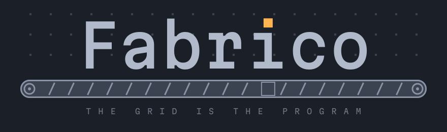

<p></p>

<p><a href="https://westpoint-io.github.io/fabrico/get-started/"><picture>
<source media="(prefers-reduced-motion: reduce)" srcset="https://westpoint-io.github.io/fabrico/hero/fabrico-hero-still.png">

</picture></a></p>

**Fabrico is an automation engine you build like a factory.** You place machines on a grid and
join them with belts, and events from the outside world, such as a webhook, ride the belts as
items. The same board given the same events ends in the same state on every run.

**[Watch it live](https://westpoint-io.github.io/fabrico/get-started/)**: the demo factory running
on the real engine in your browser.

## Install

There's no download yet, so you build Fabrico from source. On Debian or Ubuntu:

```bash
git clone https://github.com/westpoint-io/fabrico.git
cd fabrico
sudo apt-get update
sudo apt-get install -y libwebkit2gtk-4.1-dev build-essential curl wget file libxdo-dev libssl-dev libayatana-appindicator3-dev librsvg2-dev libdbus-1-dev
cd frontend
npm ci
npm run build
cd ..
cargo build -p fabrico-app --features tauri/custom-protocol
```

For macOS and Windows, and the tools to install first, see
[Install Fabrico](https://westpoint-io.github.io/fabrico/get-started/install/).

## Quickstart

1. Start the app you built:

   ```bash
   ./target/debug/fabrico-app
   ```

2. Open Examples on the toolbar and load Order processing. The board starts playing.

3. Click the Source on the left and copy its Webhook URL from the inspector, the panel on the
   right.

4. Send one order with curl, with `PORT` and `ID` from the Webhook URL:

   ```bash
   curl -X POST http://127.0.0.1:PORT/hook/src-ID \
     -H 'x-delivery-id: readme-1' \
     -d '{"id":"ord-1","items":[{"sku":"widget","qty":2,"price":5}]}'
   ```

The order shows up on the first belt as an amber dot and rides it into the validate Factory, which
splits it in two. One half reaches an HTTP Sink that posts to http://localhost:8799/fulfillment,
and that call fails unless something on your computer listens there.

If curl says it couldn't connect to the server, or that the connection was refused, check the port
in the Webhook URL. [Troubleshooting](https://westpoint-io.github.io/fabrico/troubleshooting/)
covers this and other problems.

## Links

- [Get started](https://westpoint-io.github.io/fabrico/get-started/): install the app and build
  your first factory.
- [Concepts](https://westpoint-io.github.io/fabrico/concepts/): items, ticks, belts, faults and
  replay.
- [Reference](https://westpoint-io.github.io/fabrico/reference/): every machine kind and engine
  rule, with limits generated from the code.
- [Patterns](https://westpoint-io.github.io/fabrico/patterns/): recipes for common automation
  jobs, each with a running board.
- [Troubleshooting](https://westpoint-io.github.io/fabrico/troubleshooting/): fixes, looked up by
  what you see.
- [Contributing](https://westpoint-io.github.io/fabrico/contributing/): the code layout, the
  checks, and how to change the docs.
- [Releases](https://github.com/westpoint-io/fabrico/releases): each release includes
  fabrico-examples.html, every example board in one file that runs in a browser with no network.

## Status

Fabrico is pre-1.0. There's no download yet, a newer build refuses a save made by an older one,
and machines can still change between versions.
[What it isn't yet](https://westpoint-io.github.io/fabrico/get-started/#what-it-isnt-yet) lists
the rest.

## Licence

Licensed under either of

- Apache License, Version 2.0 ([LICENSE-APACHE](LICENSE-APACHE) or
  <http://www.apache.org/licenses/LICENSE-2.0>)
- MIT license ([LICENSE-MIT](LICENSE-MIT) or <http://opensource.org/licenses/MIT>)

at your option.

The two bundled fonts, Martian Mono and Sono, are licensed separately under the SIL Open Font
License 1.1. Their licence texts and provenance are in
[frontend/src/assets/fonts/](frontend/src/assets/fonts/NOTICE.md).

### Contribution

Unless you explicitly state otherwise, any contribution intentionally submitted for inclusion in
the work by you, as defined in the Apache-2.0 license, shall be dual licensed as above, without any
additional terms or conditions.
